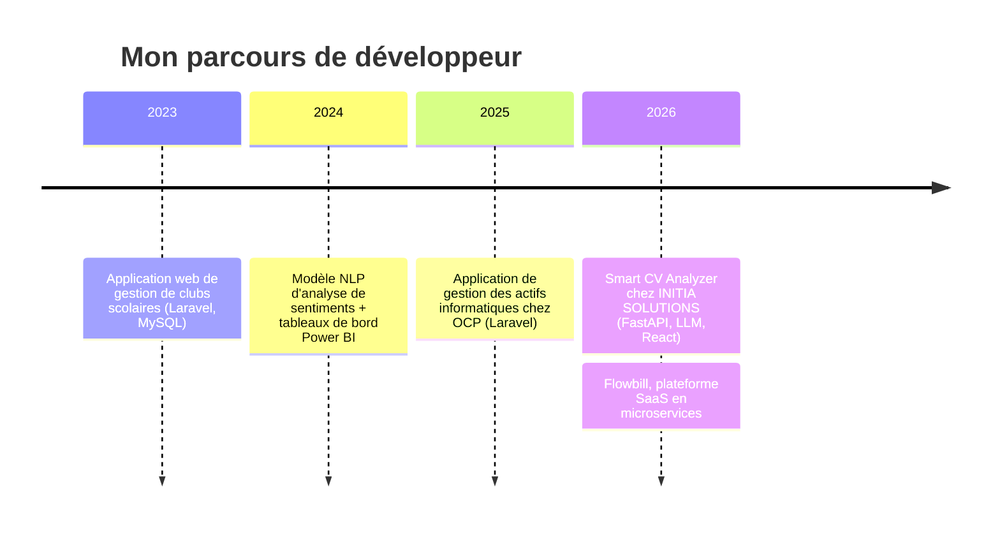

<div align="center">


<a href="https://git.io/typing-svg">
  
</a>

<br/>


</div>

---

```bash
amine@dev:~$ whoami
Mohamed Amine BAICH · Développeur Full-Stack · Ingénierie Logicielle

amine@dev:~$ cat about.txt
Je conçois et livre des applications web full-stack, de l'API à l'interface :
services REST, microservices, interfaces React / TypeScript et déploiement
avec Docker. Je m'intéresse aussi à l'intégration d'IA (LLM, NLP).

amine@dev:~$ neofetch
  ┌──────────────────────────────────────────────┐
  │  OS        : Linux / Windows                 │
  │  Base      : TanTan, Maroc 🇲🇦                 │
  │  Formation : Ingénierie Logicielle · ENSIASD │
  │  Langues   : Arabe · Français · English      │
  │  Éditeur   : VS Code / IntelliJ              │
  │  Focus     : Spring Boot · FastAPI · React   │
  │  Statut    : Ouvert aux opportunités         │
  └──────────────────────────────────────────────┘
```

---

## 📦 `ls ~/stack`

<div align="center">


</div>

<details>
<summary><code>$ cat stack.md</code> · voir le détail</summary>
<br/>

**Langages :** Java · Python · JavaScript · TypeScript · PHP · C / C++

**Backend :** Spring Boot (Security, Cloud Gateway) · FastAPI · Laravel · API REST · JWT · Microservices

**Frontend & Mobile :** React · TypeScript · Tailwind CSS · Flutter

**Bases de données :** PostgreSQL · MySQL · MongoDB · Redis

**DevOps & Outils :** Docker · Docker Compose · Git / GitHub · CI/CD · Maven · Linux · Pytest · Postman

**IA & Data :** Intégration de LLM · NLP · Machine Learning · OpenCV · Power BI

</details>

---

## 🗂️ `cd ~/projets`

<details>
<summary><code>$ cd flowbill</code> · <b>Flowbill</b>, plateforme SaaS multi-tenant (B2B)</summary>
<br/>

```text
Microservices : auth · tenants · projets · temps · facturation
Gateway       : Spring Cloud API Gateway
Sécurité      : JWT + rôles (Spring Security)
Données       : PostgreSQL, un schéma par client, migrations Flyway
Déploiement   : Docker Compose
Frontend      : React / TypeScript / Tailwind CSS
```

`Java 17` `Spring Boot 3` `React` `TypeScript` `PostgreSQL` `Docker`

👉 [Ouvrir le dépôt](https://github.com/medamine771/NOM_DU_DEPOT)

</details>

<details>
<summary><code>$ cd smart-cv-analyzer</code> · <b>Smart CV Analyzer</b>, scoring automatique de CV</summary>
<br/>

```text
Entrée   : un CV
Pipeline : API FastAPI → LLM (extraction) → calcul du score
Sortie   : compétences, expériences, formation + score
Qualité  : API testée avec Pytest et Postman
Frontend : React / Tailwind CSS
```

`Python` `FastAPI` `LLM` `React` `Tailwind CSS`

👉 [Ouvrir le dépôt](https://github.com/medamine771/NOM_DU_DEPOT)

</details>

<details>
<summary><code>$ cd mobile-groupes</code> · <b>Application mobile de gestion de groupes avec chat</b></summary>
<br/>

```text
Fonctions : gestion des membres et des groupes, messagerie intégrée
Backend   : containerisé avec Docker
```

`Flutter` `Docker`

👉 [Ouvrir le dépôt](https://github.com/medamine771/NOM_DU_DEPOT)

</details>

---

## 🧭 `git log --oneline`



---

## 📊 `./stats.sh`

<div align="center">


</div>

---

## 📡 `./contact.sh`

```bash
amine@dev:~$ ./contact.sh
> Ouvert aux opportunités professionnelles et aux collaborations.
```

<div align="center">

<a href="https://www.linkedin.com/in/mohamed-amine-baich-7bab5b258"></a>
<a href="mailto:mohamedaminebaichh@gmail.com"></a>


</div>
