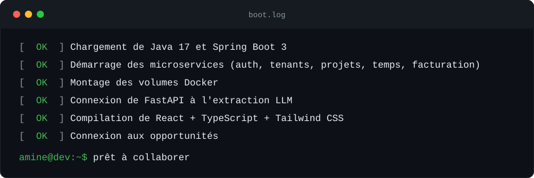
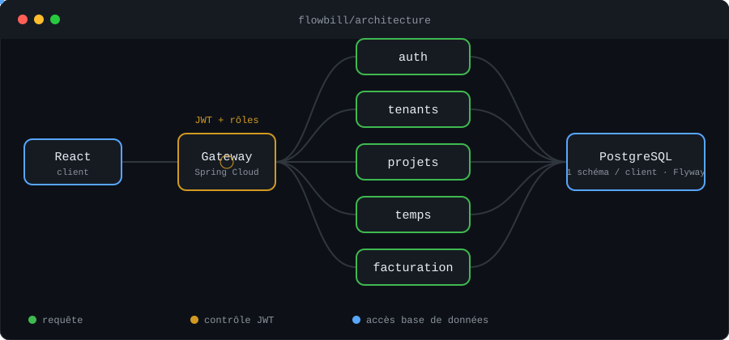
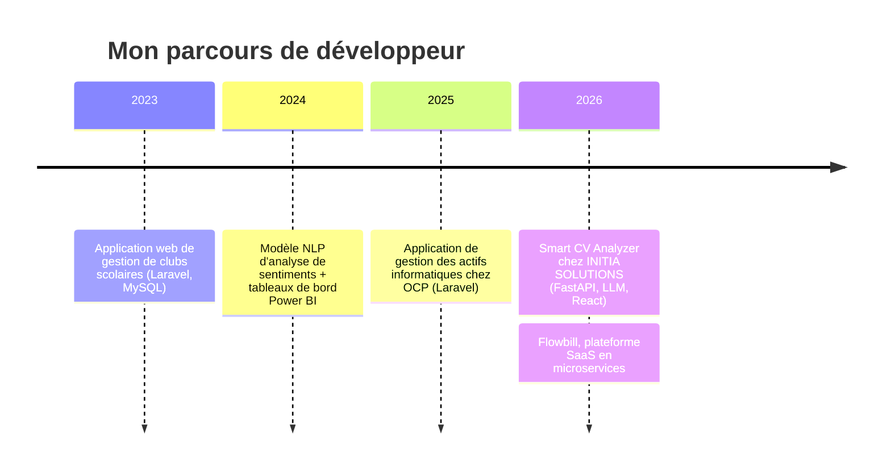

<div align="center">



</div>

```text
 █████╗ ███╗   ███╗██╗███╗   ██╗███████╗
██╔══██╗████╗ ████║██║████╗  ██║██╔════╝
███████║██╔████╔██║██║██╔██╗ ██║█████╗
██╔══██║██║╚██╔╝██║██║██║╚██╗██║██╔══╝
██║  ██║██║ ╚═╝ ██║██║██║ ╚████║███████╗
╚═╝  ╚═╝╚═╝     ╚═╝╚═╝╚═╝  ╚═══╝╚══════╝
        Du backend au frontend
```

---

## ⚙️ `systemctl start amine.service`

<div align="center">



</div>

```bash
amine@dev:~$ cat about.txt
Je conçois et livre des applications web full-stack, de l'API à l'interface :
services REST, microservices, interfaces React / TypeScript et déploiement
avec Docker. Je m'intéresse aussi à l'intégration d'IA (LLM, NLP).

amine@dev:~$ neofetch
  ┌──────────────────────────────────────────────┐
  │  OS        : Linux / Windows                 │
  │  Base      : Tantan, Maroc 🇲🇦                 │
  │  Formation : Ingénierie Logicielle · ENSIASD │
  │  Langues   : Arabe · Français · English      │
  │  Éditeur   : VS Code / IntelliJ              │
  │  Focus     : Spring Boot · FastAPI · React   │
  │  Statut    : Ouvert aux opportunités         │
  └──────────────────────────────────────────────┘
```

---

## 📊 `htop`

<div align="center">



</div>

---

## 📦 `ls ~/stack`

<div align="center">


</div>

<details>
<summary><code>$ cat stack.md</code> · voir le détail</summary>
<br/>

**Langages :** Java · Python · JavaScript · TypeScript · PHP · C / C++

**Backend :** Spring Boot (Security, Cloud Gateway) · FastAPI · Laravel · API REST · JWT · Microservices

**Frontend & Mobile :** React · TypeScript · Tailwind CSS · Flutter

**Bases de données :** PostgreSQL · MySQL · MongoDB · Redis

**DevOps & Outils :** Docker · Docker Compose · Git / GitHub · CI/CD · Maven · Linux · Pytest · Postman

**IA & Data :** Intégration de LLM · NLP · Machine Learning · OpenCV · Power BI

</details>

---

## 🐳 `docker ps`

```text
CONTAINER      IMAGE                  STATUS         PORTS / ROLE
a1f3c9d2e801   flowbill               Up 2026        microservices · gateway · PostgreSQL
b7e20c44d9a3   smart-cv-analyzer      Up 2026        FastAPI → LLM → score
c93d1a7f5b62   mobile-groupes         Up             Flutter · chat · Docker
d04e8b21c7f9   opportunites           Up (healthy)   ouvert aux collaborations
```

---

## 🗂️ `cd ~/projets`

<details open>
<summary><code>$ cd flowbill</code> · <b>Flowbill</b>, plateforme SaaS multi-tenant (B2B)</summary>
<br/>

<div align="center">



</div>

```yaml
# docker-compose.yml (aperçu)
services:
  gateway:    # Spring Cloud API Gateway · JWT + rôles (Spring Security)
  auth:       # authentification
  tenants:    # gestion des clients
  projets:    # projets
  temps:      # suivi du temps
  facturation:# facturation
  postgres:   # un schéma par client · migrations Flyway
  frontend:   # React / TypeScript / Tailwind CSS
```

`Java 17` `Spring Boot 3` `React` `TypeScript` `PostgreSQL` `Docker`

👉 [Ouvrir le dépôt](https://github.com/medamine771/NOM_DU_DEPOT) <!-- TODO: remplacer NOM_DU_DEPOT -->

</details>

<details>
<summary><code>$ cd smart-cv-analyzer</code> · <b>Smart CV Analyzer</b>, scoring automatique de CV</summary>
<br/>

```json
{
  "name": "smart-cv-analyzer",
  "pipeline": ["API FastAPI", "LLM (extraction)", "calcul du score"],
  "input": "un CV",
  "output": ["compétences", "expériences", "formation", "score"],
  "tests": ["Pytest", "Postman"],
  "frontend": "React / Tailwind CSS"
}
```

`Python` `FastAPI` `LLM` `React` `Tailwind CSS`

👉 [Ouvrir le dépôt](https://github.com/medamine771/NOM_DU_DEPOT) <!-- TODO: remplacer NOM_DU_DEPOT -->

</details>

<details>
<summary><code>$ cd mobile-groupes</code> · <b>Application mobile de gestion de groupes avec chat</b></summary>
<br/>

```text
Fonctions : gestion des membres et des groupes, messagerie intégrée
Backend   : containerisé avec Docker
```

`Flutter` `Docker`

👉 [Ouvrir le dépôt](https://github.com/medamine771/NOM_DU_DEPOT) <!-- TODO: remplacer NOM_DU_DEPOT -->

</details>

---

## 🚀 `cat .github/workflows/ci.yml`

<div align="center">



</div>

---

## 🧭 `git log --oneline`



---

## 🐍 `./snake.sh`

<div align="center">

<picture>
  <source media="(prefers-color-scheme: dark)" srcset="https://raw.githubusercontent.com/medamine771/medamine771/output/github-snake-dark.svg"/>
  
</picture>

</div>

---

## 📊 `./stats.sh`

<div align="center">


</div>

---

## ⏰ `crontab -l`

```cron
# m h  dom mon dow   commande
0  *  *   *   *     apprendre quelque chose de nouveau
0  9  *   *   1-5   docker compose up -d && git pull
30 18 *   *   1-5   git commit -m "feat: ship it"
@reboot              echo "Du backend au frontend"
```

---

## 📖 `man amine`

<details>
<summary><code>$ man amine</code> · ouvrir la page de manuel</summary>

```text
AMINE(1)                  Manuel du développeur                  AMINE(1)

NOM
       amine - développeur full-stack, du backend au frontend

SYNOPSIS
       amine [--backend] [--frontend] [--docker] [--ia]

DESCRIPTION
       Conçoit et livre des applications web full-stack : API REST,
       microservices, interfaces React / TypeScript, déploiement Docker.
       S'intéresse à l'intégration d'IA (LLM, NLP).

OPTIONS
       --backend    Spring Boot, FastAPI, Laravel
       --frontend   React, TypeScript, Tailwind CSS, Flutter
       --docker     Docker, Docker Compose, CI/CD
       --ia         LLM, NLP, OpenCV, Power BI

VOIR AUSSI
       flowbill(1), smart-cv-analyzer(1), mobile-groupes(1)

AUTEUR
       Mohamed Amine BAICH · Tantan, Maroc

                               2026                              AMINE(1)
```

</details>

---

## 📡 `./contact.sh`

```bash
amine@dev:~$ ./contact.sh
> Ouvert aux opportunités professionnelles et aux collaborations.
```

<details>
<summary><code>$ sudo hire amine</code></summary>

```bash
[sudo] mot de passe pour recruteur : ********
Vérification des compétences ......... [  OK  ]
Vérification de la motivation ........ [  OK  ]
Envoi de la proposition .............. [  OK  ]

✔ Excellente décision. Contactez-moi via LinkedIn ou par email ci-dessous.
```

</details>

<div align="center">

<a href="https://www.linkedin.com/in/mohamed-amine-baich-7bab5b258"></a>
<a href="mailto:mohamedaminebaichh@gmail.com"></a>

<br/><br/>


</div>
