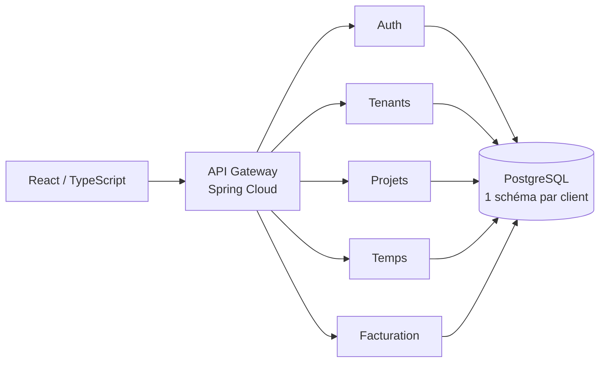
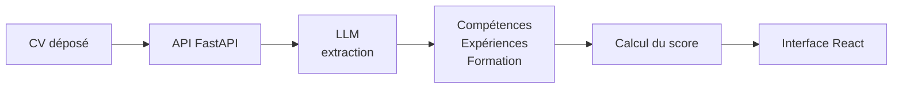

<div align="center">


<a href="https://git.io/typing-svg">
  
</a>

<br/>

<a href="https://www.linkedin.com/in/mohamed-amine-baich-7bab5b258"></a>
<a href="mailto:mohamedaminebaichh@gmail.com"></a>


</div>

---

## 👋 Salut, je suis Mohamed Amine BAICH

**Développeur Full-Stack · Ingénierie Logicielle**

Je conçois et livre des applications web full-stack, de l'API à l'interface : services REST, microservices, interfaces React / TypeScript et déploiement avec Docker. Je m'intéresse aussi à l'intégration d'IA (LLM, NLP) dans les applications.

🎓 Formation en Ingénierie Logicielle à l'ENSIASD

```javascript
// developer.js
const amine = {
  nom: "Mohamed Amine BAICH",
  role: "Développeur Full-Stack",
  base: "TanTan, Maroc 🇲🇦",
  langues: ["Arabe", "Français", "English"],
  stack: ["Java", "Spring Boot", "Python", "FastAPI", "React", "TypeScript", "Docker"],
  enCeMomentJExplore: ["Microservices", "LLM & NLP", "CI/CD"],
  philosophie: "Du code propre, des API testées, des projets livrés.",
  ouvertA: ["Opportunités professionnelles", "Collaborations"],
};
```

---

## 🛠️ Technologies

<div align="center">


<br/>

<br/>

<br/>


</div>

<details>
<summary><b>📋 Voir le détail par catégorie</b></summary>
<br/>

**Langages :** Java · Python · JavaScript · TypeScript · PHP · C / C++

**Backend :** Spring Boot (Security, Cloud Gateway) · FastAPI · Laravel · API REST · JWT · Microservices

**Frontend & Mobile :** React · TypeScript · Tailwind CSS · Flutter

**Bases de données :** PostgreSQL · MySQL · MongoDB · Redis

**DevOps & Outils :** Docker · Docker Compose · Git / GitHub · CI/CD · Maven · Linux · Pytest · Postman

**IA & Data :** Intégration de LLM · NLP · Machine Learning · OpenCV · Power BI

</details>

---

## 🚀 Projets en vedette

*Clique sur un projet pour le déplier 👇*

<details>
<summary><b>🧾 Flowbill</b> : plateforme SaaS multi-tenant (B2B)</summary>
<br/>

Microservices (auth, tenants, projets, temps, facturation) derrière une API Gateway Spring Cloud. Sécurité JWT avec rôles, un schéma PostgreSQL par client, migrations Flyway, orchestration Docker Compose, frontend React / TypeScript.



     

👉 [Voir le dépôt](https://github.com/medamine771/NOM_DU_DEPOT)

</details>

<details>
<summary><b>📄 Smart CV Analyzer</b> : analyse et scoring automatique de CV</summary>
<br/>

Application qui utilise un LLM pour extraire compétences, expériences et formation, puis calcule un score selon des critères définis. API FastAPI testée avec Pytest et Postman, interface React / Tailwind CSS.



    

👉 [Voir le dépôt](https://github.com/medamine771/NOM_DU_DEPOT)

</details>

<details>
<summary><b>📱 Application mobile de gestion de groupes avec chat</b></summary>
<br/>

Gestion des membres et des groupes, messagerie intégrée, backend containerisé avec Docker.

 

👉 [Voir le dépôt](https://github.com/medamine771/NOM_DU_DEPOT)

</details>

---

## 📊 Activité GitHub

<div align="center">


</div>

---

## 🤝 Travaillons ensemble

<div align="center">

<a href="https://www.linkedin.com/in/mohamed-amine-baich-7bab5b258"></a>
<a href="mailto:mohamedaminebaichh@gmail.com"></a>

*Ouvert aux opportunités professionnelles et aux collaborations.*


</div>

