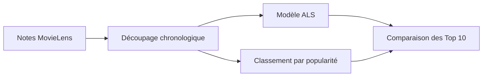

# 

Je conçois des applications web de l’API à l’interface, avec Spring Boot ou FastAPI côté serveur, React côté client et Docker pour le déploiement. J’explore aussi l’intégration de LLM et le traitement de données avec PySpark.

**Formation en ingénierie logicielle à l’ENSIASD** · **TanTan, Maroc**

[Projets](#projets) · [Technologies](#technologies) · [Contact](#contact)

## Projets

### 🎬 MovieLens · Que regarder ensuite ?

Un pipeline **Python / PySpark** qui apprend à partir de **100 836 notes** et produit un top 10 de films pour chacun des **610 utilisateurs** de MovieLens.

**Ce que le test a révélé.** Sur les notes les plus récentes, le classement par popularité a retrouvé au moins un film pertinent pour **31,13 %** des utilisateurs évalués, contre **6,43 %** pour ALS avec les paramètres testés.

[Explorer le dépôt MovieLens →](https://github.com/medamine771/movielens-pyspark)

### Trois autres réalisations

<strong>Flowbill</strong> · Facturer plusieurs clients avec une plateforme SaaS

Les services d’authentification, de gestion des clients, des projets, du temps et de facturation passent par une passerelle Spring Cloud. PostgreSQL isole les données dans un schéma par client. Flyway gère les migrations et les rôles JWT contrôlent les accès. L’interface est en React et TypeScript, avec Docker Compose pour l’orchestration.

<strong>Smart CV Analyzer</strong> · Passer d’un CV à des données évaluables

Un LLM extrait les compétences, les expériences et la formation. L’application calcule ensuite un score selon des critères définis. L’API FastAPI est testée avec Pytest et Postman. L’interface utilise React et Tailwind CSS.

<strong>Application mobile</strong> · Gérer les groupes et leur messagerie

Une application Flutter pour gérer les groupes et leurs membres, avec une messagerie intégrée et un serveur conteneurisé avec Docker.

**À parcourir aussi** · [E-commerce en microservices](https://github.com/medamine771/ecommerce-microservices) · [Projet ETL](https://github.com/medamine771/etl_project)

## Technologies

| Domaine | Technologies |
| --- | --- |
| API et services | Java, Spring Boot, Spring Security, Spring Cloud Gateway, Python, FastAPI, Laravel, REST, JWT |
| Interfaces | React, TypeScript, Tailwind CSS, Flutter |
| Données et IA | PostgreSQL, MySQL, MongoDB, Redis, PySpark, intégration de LLM, NLP, machine learning |
| Tests et déploiement | Pytest, Postman, Docker, Docker Compose, Git, GitHub, CI/CD, Maven, Linux |

Autres langages et outils

JavaScript, PHP, C, C++, OpenCV et Power BI.

## Contact

Ouvert aux opportunités professionnelles et aux collaborations. Je parle arabe, français et anglais.

[LinkedIn](https://www.linkedin.com/in/mohamed-amine-baich-7bab5b258) · [M’écrire par e-mail](mailto:mohamedaminebaichh@gmail.com)
