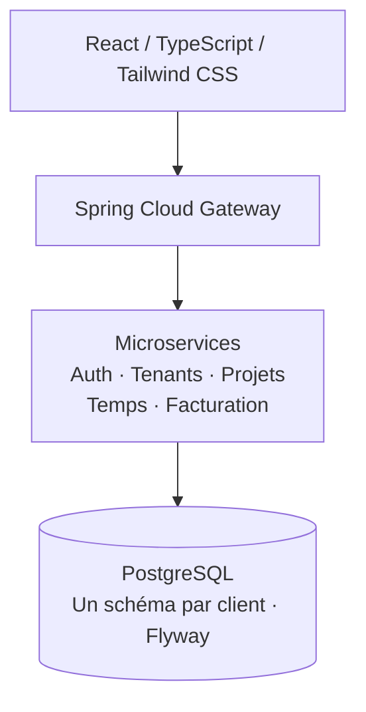

<div align="center">
  <h1>
    <picture>
      <source media="(prefers-color-scheme: dark)" srcset="assets/terminal-dark.svg" />
      
    </picture>
  </h1>
  <p><strong>Étudiant en ingénierie logicielle à l’ENSIASD</strong> · Tantan, Maroc</p>
  <p>
    <a href="#projets">Projets</a> ·
    <a href="#stack">Stack</a> ·
    <a href="#parcours">Parcours</a> ·
    <a href="#contact">Contact</a>
  </p>
</div>

## `$ cat profil.txt`

Je développe des applications de l’API à l’interface. Mes projets couvrent les microservices sécurisés, les interfaces web et mobiles, et l’intégration de LLM dans des applications.

**Langues** · Arabe, français et anglais  
**Disponibilité** · Ouvert aux opportunités professionnelles et aux collaborations

<a name="projets"></a>

## `$ ls ~/projets`

### Flowbill · SaaS de facturation B2B

Une plateforme multi-tenant pour suivre les projets, le temps et la facturation. PostgreSQL isole les données dans un schéma par client, avec Flyway pour les migrations. Spring Security contrôle les accès avec JWT et des rôles.

```text
gateway  Spring Cloud Gateway
web      React · TypeScript
styles   Tailwind CSS
runtime  Docker Compose
```

<details>
<summary><strong>Voir l’architecture de Flowbill</strong></summary>

L’interface React appelle l’API Gateway. La passerelle achemine les requêtes vers les cinq microservices, qui utilisent PostgreSQL.



</details>

<!-- TODO Flowbill : remplacer https://github.com/medamine771/NOM_DU_DEPOT par l’URL du dépôt avant d’ajouter un lien visible. -->

### Smart CV Analyzer · Extraction et scoring de CV

L’API FastAPI utilise un LLM pour extraire les compétences, les expériences et la formation, puis calcule un score selon des critères définis.

```text
entrée   CV → FastAPI
calcul   Extraction LLM → score
tests    Pytest · Postman
web      React · Tailwind CSS
```

<!-- TODO Smart CV Analyzer : remplacer https://github.com/medamine771/NOM_DU_DEPOT par l’URL du dépôt avant d’ajouter un lien visible. -->

### Application mobile · Groupes et messagerie

Une application Flutter pour gérer les groupes et leurs membres et échanger dans une messagerie intégrée. Le backend est conteneurisé avec Docker.

<!-- TODO Application mobile : remplacer https://github.com/medamine771/NOM_DU_DEPOT par l’URL du dépôt avant d’ajouter un lien visible. -->

<a name="stack"></a>

## `$ tree ~/stack`

<picture>
  <source media="(prefers-color-scheme: dark)" srcset="assets/skills-dark.svg" />
  
</picture>

- **Backend** · Java, Spring Boot, Spring Security, Spring Cloud Gateway, Python, FastAPI, Laravel.
- **Frontend et mobile** · React, TypeScript, Tailwind CSS, Flutter.
- **Données et IA** · PostgreSQL, MySQL, MongoDB, Redis, intégration de LLM et NLP, OpenCV, Power BI.
- **DevOps et qualité** · Docker, Docker Compose, Git, CI/CD, Maven, Linux, Pytest, Postman.

<a name="parcours"></a>

## `$ git log --oneline`

- **2026** · Smart CV Analyzer chez INITIA SOLUTIONS et plateforme Flowbill.
- **2025** · Application de gestion des actifs informatiques chez OCP avec Laravel.
- **2024** · Modèle NLP d’analyse de sentiments et tableaux de bord Power BI.
- **2023** · Application web de gestion de clubs scolaires avec Laravel et MySQL.

<details>
<summary><code>git log --graph</code> · Voir l’animation des contributions GitHub</summary>

<picture>
  <source media="(prefers-color-scheme: dark)" srcset="assets/contributions-dark.svg" />
  
</picture>

[Consulter le calendrier sur GitHub](https://github.com/medamine771)

</details>

<a name="contact"></a>

## `$ ./contact.sh`

Pour une opportunité ou une collaboration, tu peux me retrouver sur [LinkedIn](https://www.linkedin.com/in/mohamed-amine-baich-7bab5b258) ou [m’écrire par e-mail](mailto:mohamedaminebaichh@gmail.com).

<details>
<summary><code>sudo hire amine</code></summary>

```text
Accès accordé.
```

Si tu as un projet en tête, raconte-moi ce que tu construis et le problème que tu veux résoudre.

</details>
